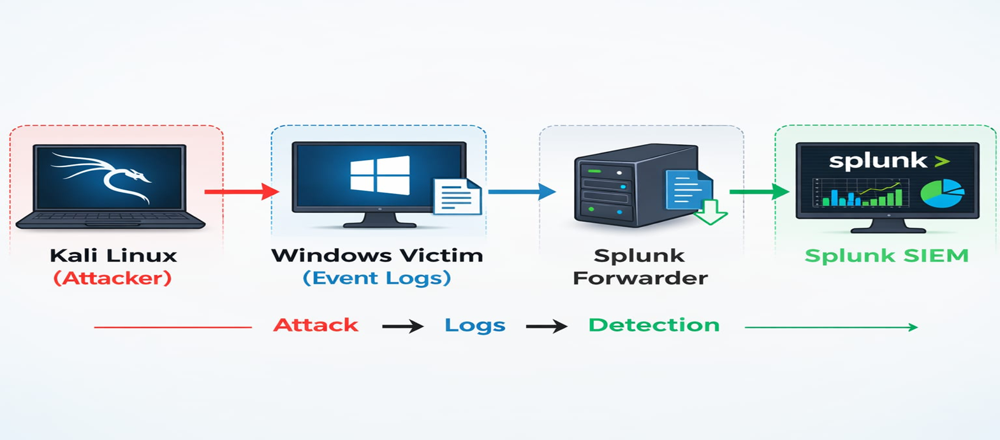
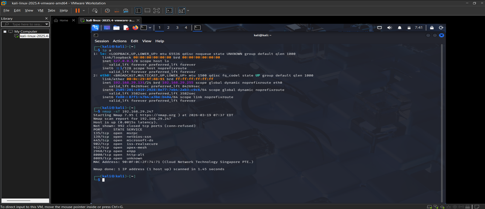
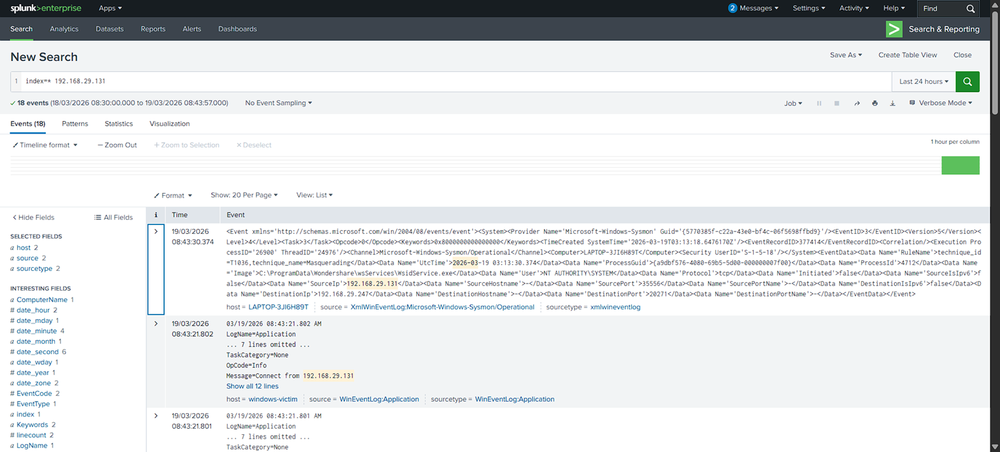
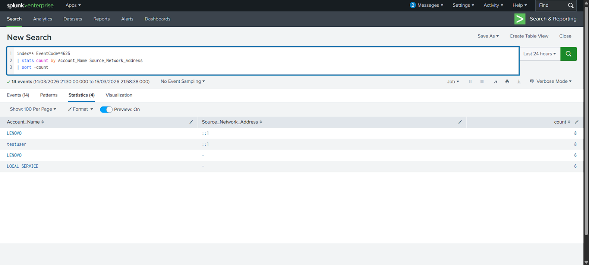

# 👨‍💻 Vignesh Kilambi

### 🚨 SOC Home Lab: Attack Simulation & Detection

This project demonstrates a real-world cyber attack simulation using **Kali Linux** and detection using **Splunk SIEM** with **Sysmon logs**.

---

## 🏗️ Lab Architecture

The lab consists of:

* **Kali Linux (Attacker)**
* **Windows Machine (Target)**
* **Splunk SIEM (Monitoring & Detection)**
* **Sysmon (Log Collection)**



---

## ⚔️ Attack Simulation

An attacker machine (Kali Linux) performed reconnaissance using an **Nmap scan** on the target system.

### 🔹 Command Used:

```bash
nmap -sT <target-ip>
```

### 🔹 Outcome:

* Identified open ports on the target machine
* Generated network activity logs



---

## 🔍 Detecting Attacker Activity (Sysmon Logs)

Sysmon Event ID **3 (Network Connection)** was analyzed in Splunk to detect communication between attacker and victim.

### 🔹 Key Findings:

* Source IP → Attacker (Kali Linux)
* Destination IP → Target (Windows)
* Network connection successfully captured



---

## 🚨 Brute Force Attack Detection

Multiple failed login attempts were detected using Windows Security logs (**Event ID 4625**).

### 🔹 Detection Query:

```spl
index=wineventlog EventCode=4625
| stats count by Account_Name, Source_Network_Address
| where count > 5
| sort - count
```

### 🔹 Analysis:

* Repeated failed login attempts observed
* Suspicious behavior identified as brute-force attack



---

## 🧠 MITRE ATT&CK Mapping

| Technique        | ID    | Description                                     |
| ---------------- | ----- | ----------------------------------------------- |
| Brute Force      | T1110 | Multiple login attempts using password guessing |
| Network Scanning | T1046 | Scanning open ports using tools like Nmap       |

---

## 🛠 Tools Used

* Splunk SIEM
* Sysmon
* Kali Linux
* Nmap
* Windows Event Logs

---

## 📁 Project Structure

```
splunk-soc-attack-detection-lab/
│── images/
│── queries/
│── detections/
│── logs/
│── reports/
│── setup/
│── mitre-mapping/
│── project-files/
```

---

## 📂 Project Files

* Full project PPT available in `project-files/`

---

## 📊 Outcome

* Simulated real-world cyber attack scenario
* Detected attacker activity using SIEM
* Identified brute-force login attempts
* Performed log analysis and investigation

---

## 🎯 Skills Gained

* SIEM Monitoring (Splunk)
* Log Analysis (Sysmon & Windows Logs)
* Threat Detection
* Incident Investigation
* Basic Blue Team Operations

---

## 📌 Author

**Vignesh Kilambi**
Aspiring SOC Analyst
